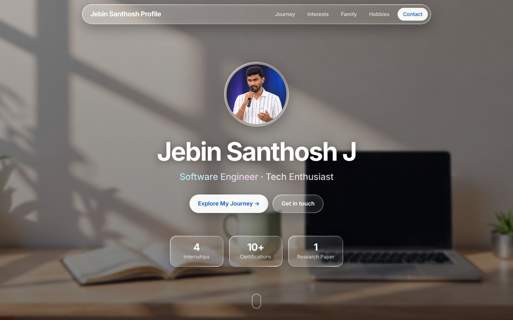

# Jebin Santhosh J | Profile Website

A single-page personal profile website with an Apple-inspired **liquid glass** design, built with plain **HTML, CSS and vanilla JavaScript**, and shipped through a complete **GitHub Actions CI/CD pipeline** to GitHub Pages.

**Live site:** https://jebin-santhosh-psiog.github.io/JebinSanthosh-Profile/



---

## Contents

- [Highlights](#highlights)
- [Sections](#sections)
- [Tech stack and constraints](#tech-stack-and-constraints)
- [Project structure](#project-structure)
- [Theming system](#theming-system)
- [CI/CD pipeline](#cicd-pipeline)
- [Branching strategy](#branching-strategy)
- [Run it locally](#run-it-locally)
- [Validate locally](#validate-locally)
- [Accessibility and performance](#accessibility-and-performance)
- [Contact](#contact)

---

## Highlights

- **Liquid glass UI:** frosted translucent panels with light-catching edges over a soft photo background.
- **Apple-inspired interactions:** macOS-style widgets, a Terminal that types itself out, iOS Contact Posters that flip to an iMessage thread, and a Photos window with a magnifying Dock and Quick Look.
- **Single-file theming:** every colour, font and spacing value lives in `css/theme.css`.
- **No frameworks:** no React, no Bootstrap, no jQuery. Everything is hand-written HTML, CSS and JavaScript.
- **Automated pipeline:** every pull request is linted and checked, every merge to `main` deploys automatically, and every deployment is audited by Lighthouse.
- **Fully responsive:** tested on desktop, tablet and mobile widths.

## Sections

| # | Section | What it shows | Key techniques |
|---|---|---|---|
| 1 | **Hero** | Photo, name, title, call-to-action buttons and stats | Flexbox centring, load animation with `@keyframes` |
| 2 | **Professional Journey** | Nine milestones from school to the present | Sticky "chapter" panel, timeline line and dots drawn with `::before` / `::after`, progress fill on scroll, Show more toggle |
| 3 | **Personal Likings** | Music, instruments, technology, books, food and travel | CSS Grid bento layout (3 / 2 / 1 columns), widget cards with hover lift, working play button, self-typing Terminal, checklist, Switzerland map |
| 4 | **Family** | Family photo and a card for each member | Photos-style Memories banner, CSS 3D flip cards (`perspective`, `backface-visibility`), warm sub-palette scoped to the section |
| 5 | **Hobbies & Passions** | Videography, cricket, gaming, travel and build projects | Masonry gallery with CSS columns, sidebar filters, Dock with hover magnification, vanilla JS lightbox (keyboard, previous / next, Esc to close) |
| 6 | **Contact (footer)** | LinkedIn, GitHub and email links | Auto-updating copyright year, floating back-to-top button |

## Tech stack and constraints

| Layer | Used |
|---|---|
| Markup | HTML5 with semantic tags (`header`, `nav`, `main`, `section`, `article`, `figure`, `footer`) |
| Styling | CSS3: custom properties, Flexbox, Grid, transitions, keyframe animations, `backdrop-filter` |
| Scripting | Vanilla JavaScript (ES6+): DOM APIs and `IntersectionObserver` |
| Hosting | GitHub Pages |
| CI/CD | GitHub Actions |
| Linting | HTMLHint, CSSLint |
| Auditing | Lighthouse CI |

**Project rules followed:**

- No CSS or JS frameworks or libraries.
- No colour or font values hard-coded in `style.css`; everything comes from `theme.css` through `var()`.
- No inline `style=""` attributes.
- No `console.log` left in production JavaScript.
- Every `` has an `alt` attribute.

## Project structure

```
JebinSanthosh-Profile/
├── .github/
│   └── workflows/
│       ├── validate.yml      # HTML and CSS linting
│       ├── deploy.yml        # Deploy to GitHub Pages
│       ├── pr-checks.yml     # Pull request quality gates
│       ├── lighthouse.yml    # Performance and accessibility audit
│       └── notify.yml        # Deployment notifications
├── css/
│   ├── theme.css             # All design tokens (colours, fonts, spacing, radii)
│   └── style.css             # Layout and components, using var() only
├── js/
│   └── main.js               # All interactions
├── images/
│   ├── bg/                   # Page background
│   ├── hero/                 # Profile photo
│   ├── family/               # Family photo and member portraits
│   ├── hobbies/              # Hobby gallery images
│   └── interests/            # Instrument posters and travel map
├── docs/
│   └── screenshot.jpg        # README screenshot
├── index.html
├── .htmlhintrc               # HTMLHint rules
├── .gitignore
└── README.md
```

## Theming system

All visual values are defined once as CSS custom properties in `css/theme.css` (excerpt):

```css
:root {
  --color-text: #ffffff;
  --color-accent: #0a84ff;
  --glass-bg: linear-gradient(135deg, rgba(255, 255, 255, 0.16), rgba(255, 255, 255, 0.03));
  --font-heading: -apple-system, BlinkMacSystemFont, 'SF Pro Display', 'Segoe UI', Roboto, 'Helvetica Neue', Arial, sans-serif;
  --border-radius: 28px;
}
```

`css/style.css` only ever reads them:

```css
.card {
  background: var(--glass-bg);
  border-radius: var(--border-radius);
}
```

**To re-theme the whole site, edit only `css/theme.css`.** For example, changing `--color-accent` updates every button, active link, timeline dot and highlight at once. The Family section overrides a few variables for its warm palette, so a section-level theme needs no changes to `style.css` either.

## CI/CD pipeline

```
feature branch ──PR──► develop ──PR──► main ──► Deploy ──► Live site
                 │                 │              │
           Validate HTML     PR Quality      ┌────┴──────────┐
              & CSS            Checks     Lighthouse     Notification
```

| # | Workflow | File | Runs when | What it does |
|---|---|---|---|---|
| 1 | Validate HTML & CSS | `validate.yml` | Push to `main` or `develop`, and PRs to `main` | Lints `index.html` with HTMLHint and `style.css` with CSSLint |
| 2 | Deploy to GitHub Pages | `deploy.yml` | Push to `main` | Publishes the site to GitHub Pages |
| 3 | PR Quality Checks | `pr-checks.yml` | PRs to `main` | Checks every page has a `<title>`, every image has `alt`, and no `console.log` remains; `all-checks-passed` gates the merge |
| 4 | Lighthouse Audit | `lighthouse.yml` | After a successful deploy, and every Monday at 09:00 UTC | Audits performance, accessibility, best practices and SEO; uploads the report as a downloadable artifact |
| 5 | Deployment Notification | `notify.yml` | After every deploy | Reports success or failure; ready to post to Slack through the `SLACK_WEBHOOK_URL` secret |

**Branch protection on `main`:** changes must arrive through a pull request, and the `all-checks-passed` status check must pass before merging.

**Linter notes:** CSSLint predates CSS custom properties, so `theme.css` (which contains only variables) is excluded, and outdated rules such as old-browser warnings are ignored in `validate.yml`. All real styles in `style.css` are still linted.

**Lighthouse report:** open **Actions → Lighthouse Audit →** the latest run **→ Artifacts → `lighthouse-report`**.

## Branching strategy

| Branch | Purpose |
|---|---|
| `main` | Production. Only receives merges from `develop`. Every merge deploys |
| `develop` | Integration. All feature work is merged here first |
| `feature/*` | New sections and content, e.g. `feature/journey-timeline`, `feature/hobbies-gallery` |
| `ci/*` | Pipeline changes, e.g. `ci/setup-deploy`, `ci/setup-lighthouse` |
| `fix/*` | Fixes, e.g. `fix/videography-and-image-sizes` |

**Workflow for every change:**

```bash
git checkout develop
git pull
git checkout -b feature/my-change
# make changes
git add <files>
git commit -m "Describe the change"
git push -u origin feature/my-change
```

1. Open a pull request into `develop`, merge it, and delete the branch.
2. To release, open a pull request from `develop` into `main`, wait for all checks to pass, and merge.
3. Deploy, Lighthouse and the notification run automatically.

## Run it locally

No build step and no dependencies are needed.

```bash
git clone https://github.com/Jebin-Santhosh-Psiog/JebinSanthosh-Profile.git
cd JebinSanthosh-Profile
```

Then open `index.html` in a browser, or use the **Live Server** extension in VS Code for automatic reloads.

## Validate locally

Run the same checks as the pipeline before pushing (requires Node.js):

```bash
npx htmlhint "*.html" --config .htmlhintrc
npx csslint css/style.css --quiet --ignore=known-properties,order-alphabetical,universal-selector,box-sizing,compatible-vendor-prefixes,fallback-colors,adjoining-classes,box-model,qualified-headings,unique-headings,important,font-sizes
grep -rn "console.log" js/ || echo "No console.log found"
```

## Accessibility and performance

- Semantic landmarks, one `<h1>`, and headings in order.
- Descriptive `alt` text on content images; decorative images use empty `alt`.
- `aria-label` on icon-only buttons, and `aria-expanded` on the mobile menu.
- Keyboard support: flip cards respond to Enter and Space; the lightbox supports arrow keys and Esc.
- Visible focus outlines for keyboard users.
- `prefers-reduced-motion` respected: animations are minimised when the user asks for it.
- Images resized and compressed for the web, and lazy-loaded below the fold.

## Contact

- **LinkedIn:** [linkedin.com/in/jebin-santhosh](https://www.linkedin.com/in/jebin-santhosh)
- **GitHub:** [github.com/Jebin-Santhosh-Psiog](https://github.com/Jebin-Santhosh-Psiog)
- **Email:** [jebin.santhosh@psiog.com](mailto:jebin.santhosh@psiog.com)

---

© 2026 Jebin Santhosh J. Built with HTML, CSS and JavaScript, and deployed with GitHub Actions.
